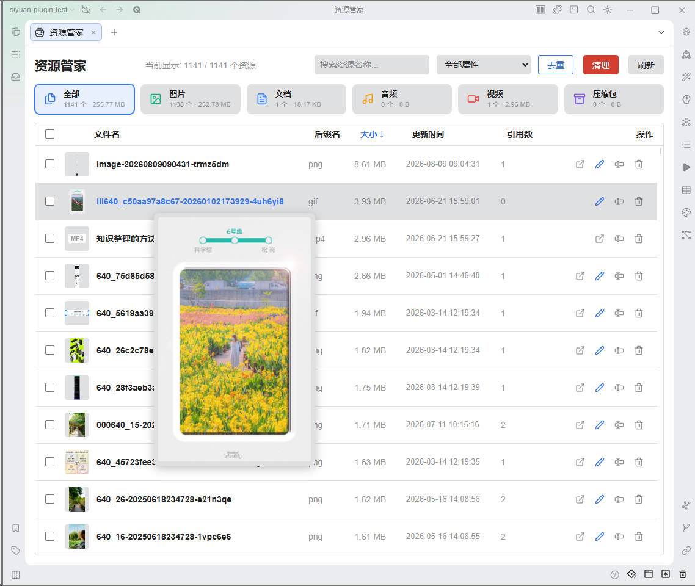
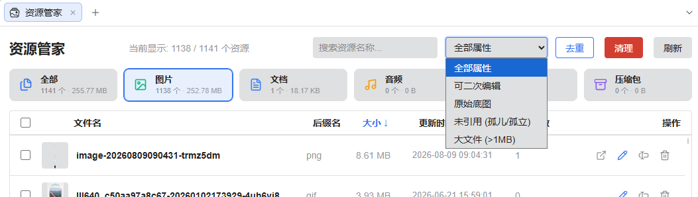
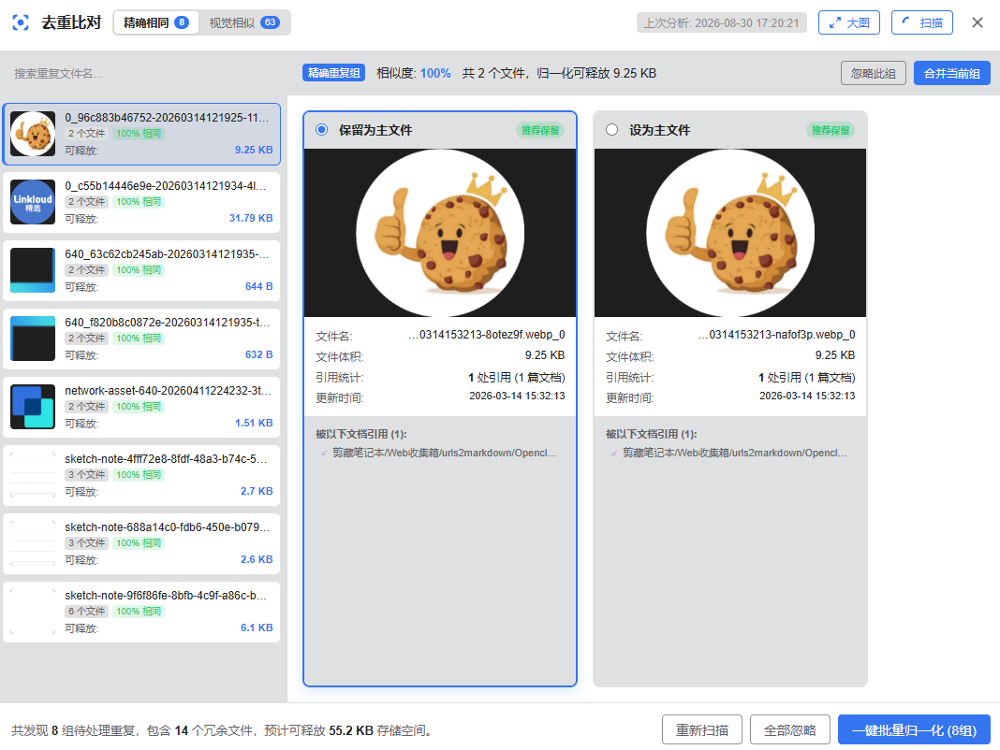
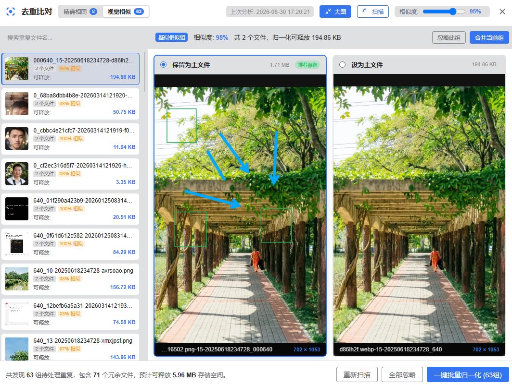
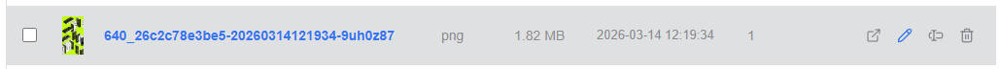
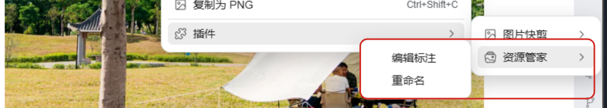
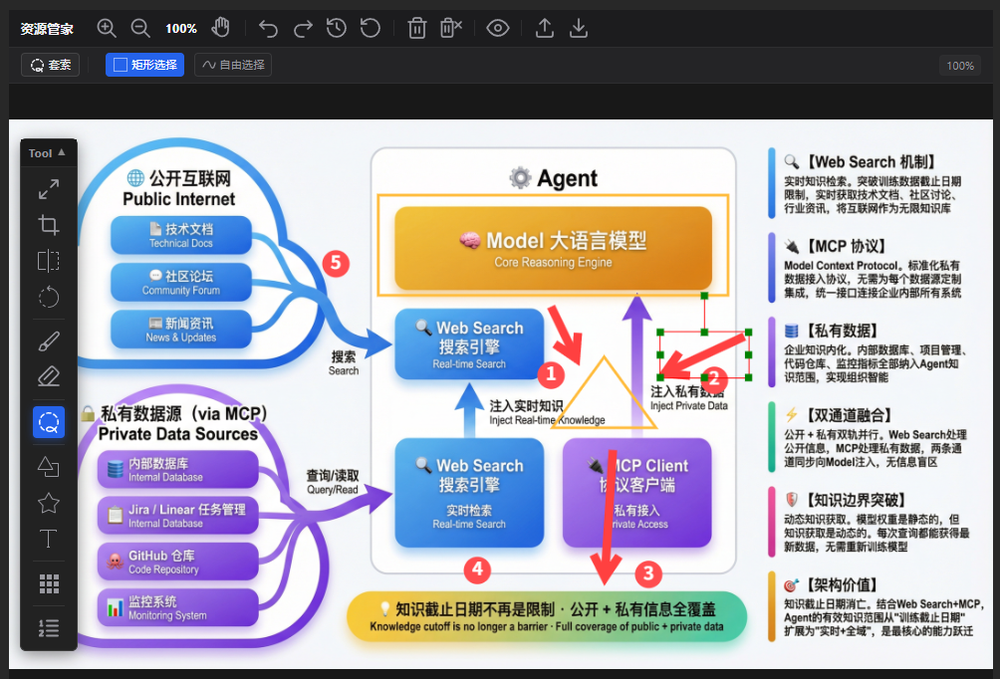

# See Every Asset at a Glance, Sweep Away the Redundancy — Assets Manager for SiYuan Note Feature Preview

> Make the asset files in your SiYuan Note workspace **clear to see, easy to find, safe to edit, and clean to keep**.
> Say goodbye to garbled filenames, broken links, duplicate clutter, and images that can never be edited a second time.

## 🧐 Do these pain points sound familiar in your daily note-taking?

### Asset Management Pain Points

- 🔍 **Can't tell where an asset is used**: You want to clean up a large video or PDF, but you have no idea which documents reference it — reverse reference tracking simply isn't available?
- 👥 **Repeated pasting bloats your storage**: The same architecture diagram or illustration gets pasted as copies into multiple notes, piling up identical or near-identical duplicates in the `assets` folder and wasting cloud sync space for nothing?
- 🧹 **No clue which files can be deleted**: After rounds of editing and deleting notes, the `assets` directory balloons to several gigabytes, and which attachments are still in use versus long abandoned as "orphan files" is a complete mystery — too risky to clean up?
- 🔗 **Afraid that renaming will break links**: Images and attachments in your notes all carry meaningless names like `image-2023...`; you'd love to organize and rename them, but you dread every image in your documents turning into a broken red cross?
- 🎨 **Image annotations you can't revise**: While writing a tutorial or memo, you take a screenshot, draw boxes, and add step numbers — then find a typo or the order has changed. You can't move the earlier arrows or fix the text, so you reluctantly re-capture and re-annotate everything?

**Assets Manager is the capable assistant built to put all of these asset management problems behind you for good.**

## 🌟 Core Value & Key Features

### 📊 6-Category Dashboard & High-Performance Browsing

- **At-a-glance category statistics**: The top of the panel shows file counts and size share for the six major categories — **Images, Documents, Audio, Video, Archives, Others**.
- **Silky-smooth browsing over massive libraries**: High-performance virtual scrolling keeps everything fluid with millisecond-level response, even with tens of thousands of images and attachments in your workspace.
- **Multi-dimensional filtering & sorting**: Real-time keyword search; filters by re-editable / original base image / unreferenced / large file (>1MB); two-way sorting by size, name, and reference count.
- **Quick hover preview**: Hover over any thumbnail and a high-resolution preview pops up adaptively right inside the panel — no repeated clicking to open.

### 🧹 Deep Cleanup of Orphan Assets & Stranded Base Images — Safe and Transparent

- **Full-workspace reference scan**: One click precisely finds "orphan assets" that no document references, as well as stale base images left behind by history.
- **Storage estimate before cleanup**: Clearly shows the total number of files to be cleaned and the storage capacity expected to be freed; clean items one by one or in a single batch.
- **Automatic empty-block cleanup**: When an asset is removed, the plugin automatically cleans up the empty blocks left in your documents, keeping layouts neat and tidy.
- **Reverse reference tracing**: Want to know which notes use a given resource? Click the "Open" button and the plugin automatically opens every document that references it in the background and highlights the exact location — tracing context is effortless.

### 🔄 Operation Audit & Smart Reverse Rollback — Deep Recycle Bin Integration, Restore Anytime

- **Full-pipeline operation audit log**: Single-file deletions, batch deletions, orphan cleanup, and dedup merges are all logged in detailed batches, with freed capacity and affected documents at a glance.
- **Operating system recycle bin integration**: Physically deleted files are moved to the OS recycle bin first, with one-click access to the recycle bin window and a shortcut to copy the list of files to restore.
- **Smart reverse reference rollback**: One click rolls back the replacement syntax produced by deduplication, and restores document body, block attribute (e.g. header image), and attribute view (database) cell references for deleted images; built-in smart content-drift protection never overwrites newer edits.

### ⚡ Smart Deduplication & Similar-Image Normalization — Slim Down Your Workspace in One Click

- **Precise hashing & visual similarity comparison**: Intelligently detects files that are exact duplicates, as well as highly similar images produced by cropping, resizing, or compression.
- **Intuitive side-by-side comparison view**: Compare image details, file dimensions, space usage, and the distribution of referencing documents for each side, left versus right.
- **One-click merge (normalization)**: Keep a single master file; the plugin automatically redirects all redundant references to the master and safely deletes the duplicates, instantly freeing precious sync and storage space.

### 🏷️ Global Smart Rename — No More Garbled Filenames, Links Never Break

- **Renames sync references automatically**: Rename an asset directly from the asset list or a document image's context menu, and the plugin updates every document and block referencing it across the workspace — **never producing a dead link**.
- **Smart extension handling & validation**: Forgot the extension? It's auto-completed. Changing an extension triggers a proactive warning. Illegal characters are blocked automatically — safe and worry-free.

### 🎨 "Non-Destructive Secondary Editing" — A Full-Featured Image Editor, Annotations Always Editable

- **Smart annotation layer retention**: Rectangles, arrows, text notes, and continuous step numbers added to images inside SiYuan are stored as **editable vector layers**, ready to be edited again and again at any time.
- **Lossless base image restoration**: The original clean base image is safely archived; when you edit again you can **move elements, revise text, reorder step numbers, and change colors** whenever you like, while the base image stays perfectly clean — no leftover smearing or artifacts.
- **Seamless document sync**: One click to save after editing, and every note page referencing that image refreshes automatically and seamlessly — no manual re-uploading or replacing.

## 🔒 Safety & Recommendations

1. **Cleanup operations**: Physical file deletion and orphan cleanup are irreversible. Before executing them, the plugin always shows clear prompts with counts and sizes and asks for a second confirmation. Before any large-scale cleanup, make sure you have routine backups in place or SiYuan cloud snapshots enabled.
2. **File rename operations**: When renaming, the plugin automatically validates illegal characters and automatically updates every document block across the workspace that references the asset. Manually naming asset files may conflict with SiYuan's automatic naming — please use this feature with care.
3. **Deduplication & merge (normalization) operations**: Merging redirects all redundant references to the kept master file and deletes the remaining duplicates. Carefully review image details and file information in the side-by-side comparison view before merging.
4. **Image secondary editing**: Original base images are safely isolated in the plugin's storage directory (​`/data/storage/petal/siyuan-assets-manager/originals/`) and are not affected by SiYuan's native cleanup. If all image blocks referencing a base image have been deleted, you can safely free the storage via "Stranded base image cleanup" in the management panel.

‍

## 🙏 Acknowledgements

1. The [ImgReEditor](https://github.com/Achuan-2/siyuan-plugin-imgReEditor) plugin project (author: Achuan-2): This plugin draws on its idea of image secondary editing and, combined with isolated archiving of base images, avoids the problems of unrecoverable base images and destroyed edit history after editing.
2. The [tui.image-editor](https://github.com/nhn/tui.image-editor/) project (author: NHN Cloud): The image editor in this project is deeply customized and enhanced on top of tui.image-editor, including:

   - A substantially reworked interface with a Photoshop-like toolbar and configuration panel, solving the original's problem of tools occupying editing space and covering the image;
   - The number tool supports continuous step-number annotation with automatic numbering;
   - The mosaic tool supports smearing over sensitive image areas;
   - The lasso tool supports selecting and processing objects;
   - The eraser tool supports removing any smeared content;
   - And much more...

‍
